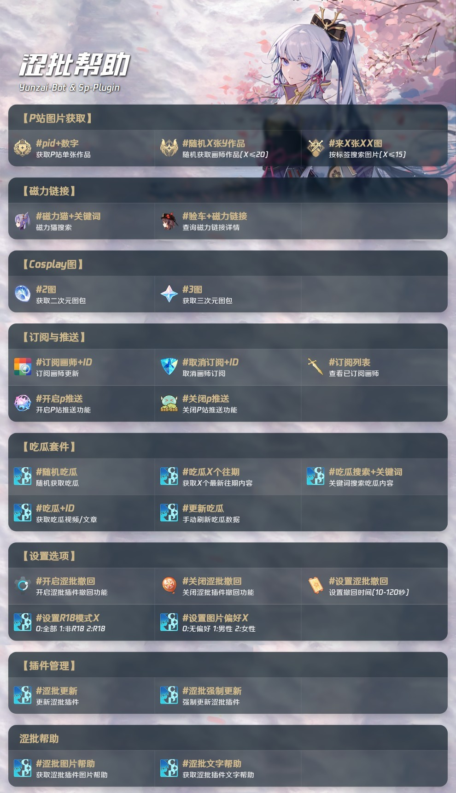

# 安装说明

## 安装

Gitee源（国内首推）
```bash
git clone https://gitee.com/q1638276310/sp-plugin.git ./plugins/sp-plugin/
```

Github源（国外推荐）
```bash
git clone https://github.com/1638276310/sp-plugin.git ./plugins/sp-plugin/
```

SSH源（需配置SSH密钥）
```bash
git clone git@gitee.com:q1638276310/sp-plugin.git ./plugins/sp-plugin/   #Gitee SSH
git clone git@github.com:1638276310/sp-plugin.git ./plugins/sp-plugin/   #GitHub SSH
```

## 安装依赖

```bash
pnpm i --filter=sp-plugin
```

## 开源协议声明
本项目基于 [所有二刺螈都得死——kkp-plugin](https://gitee.com/dungeonmaster/kkp-plugin) 二次开发。
- 原项目采用 AFL (Academic Free License) 3.0 开源协议。
- 本项目在继承原代码的基础上进行了修改与扩展，新增部分代码采用 MIT 协议。
- 请您在参考、使用或分发本项目时，遵守上述两种协议的规定，尤其必须保留原项目的所有版权声明与归属信息。


## 说明

- 本插件兼容Miao-Yunzai/Trss-Yunzai
- 兼容ICQQ（OICQ）、NCQQ
- 妹子图（mzt.js）支持 `#写真馆` / `#潮拍馆`：只走一条链路 —— 指令 ID → 美之图 APP
  全量接口（mTLS 客户端证书 `config/mzt_client.pem`，随仓库附带）→ 内置解密 →
  按解密返回的图片 URL 下载；不再访问站点 HTML 页面、不启动浏览器、失败不回退直连。
  证书来自官方 APK，仅用于访问图片接口；若本仓库公开，该证书也会随之公开。
- 妹子图相关配置（`apps/mzt.js` 顶部 `MZT_CONFIG`，常量即配置）：
  - `mzt_proxy`: APP 接口与图片下载统一 http/https 代理（如 `http://127.0.0.1:7890`），空=直连；
  - `mzt_app_cert`: 自定义 mTLS 证书路径，只接受插件目录内相对路径，空= `config/mzt_client.pem`；
  - `mzt_app_api` / `mzt_hd` / `mzt_max_images`: 与 AstrBot 版语义一致。
- `#更新写真ID` 已停用：不再直连列表页（Cloudflare 403）；写真 ID 列表改为手动放入
  `data/sp-plugin/mztids.json`（可沿用旧数据）。
- 抓取失败会明确报错（`APP接口:...；...`），日志 `[mzt] stage=cert/app/decrypt ... status=...
  cf-ray=...` 便于定位；URL 已去掉 `sign`，不打印 Cookie/证书/HTML。
- 独立诊断（不依赖 Bot 启动）：
  `node plugins/sp-plugin/tools/mzt_diag.js --id 171317 [--proxy http://127.0.0.1:7890] [--json]`

## 相关项目

- **AstrBot 版涩批插件 astrbot_plugin_sp**：<https://github.com/1638276310/astrbot_plugin_sp.git>

## 如果您对本插件有更好的代码建议，请提交Issues或Pull Requests

## Future

- mzt.js 已与 AstrBot 版对齐：只保留“APP 接口 + 内置解密”链路，并提供 `tools/selftest_mzt_chain.js` 离线自检。

## ✨ 功能    欢迎加群991639461



